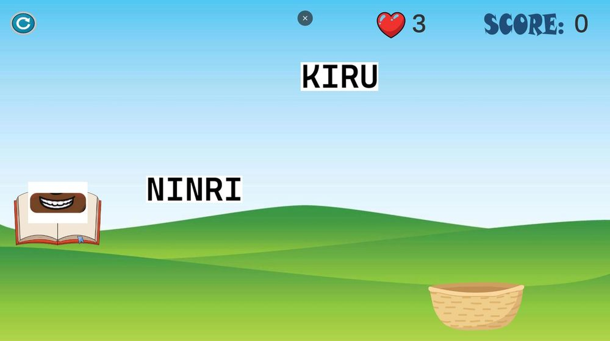
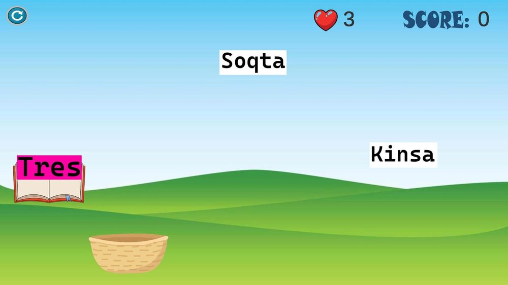
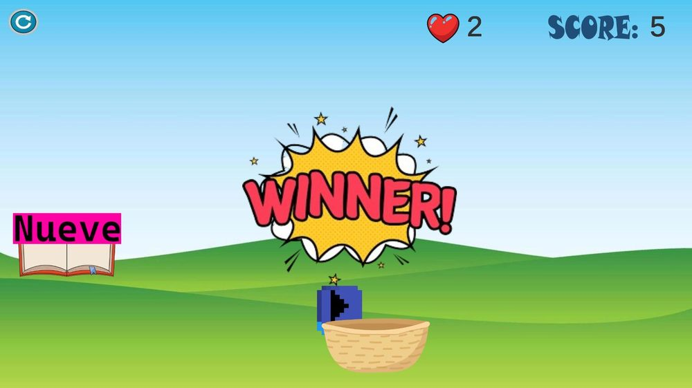

# Yachay

Juego en Unity para aprender vocabulario en quechua. El libro muestra una pista en español, con texto o con imagen, y caen palabras en quechua. Hay que mover la canasta para atrapar la traducción correcta antes de quedarse sin vidas.

Se juega en el navegador: [abduzcan17.itch.io/yachay](https://abduzcan17.itch.io/yachay)



Lo hice para el curso de Desarrollo de Videojuegos de la UNSA en diciembre de 2024. La mecánica de atrapar objetos que caen la tomé de un tutorial de YouTube y la adapté al quechua, con tres niveles de vocabulario.

## Niveles

1. Números del cero al diez.
2. Colores.
3. Partes del cuerpo, con la pista en imagen.

Atrapar una palabra equivocada quita una vida. Al completar la ronda sale la pantalla de victoria, y al perder las vidas, la de game over.

<p>


</p>

## Abrirlo en Unity

El repositorio solo tiene la carpeta `Assets`, porque la configuración del proyecto original no se guardó. Para abrirlo:

1. Crear un proyecto 2D con Unity 2021.3 (la build original es de la 2021.3.1f1).
2. Copiar la carpeta `Assets` dentro del proyecto.
3. En Tags and Layers, agregar los tags `referenceLetter`, `rightLetter` y `wrongLetter`.
4. En Build Settings, agregar las escenas en este orden: `Menu`, `Level1`, `Level2` y `Level3`. El menú carga la escena 1 al darle Play.

## Estructura

```
Assets/
  Scenes/    menú y tres niveles
  Scripts/   GameManager, aparición y colisión de palabras, movimiento de la canasta
  Prefabs/   palabras en español y quechua de cada nivel
  Sprites/   palabras, pistas y UI
  Sounds/    música de fondo y efectos de acierto y error
```
